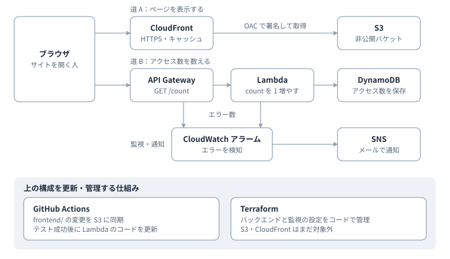

# Cloud Resume Challenge (AWS)

**最終更新 / Last updated:** 2026-11-14 15:05 (JST)

運用保守・構築・障害対応の経験を、AWS の構築・自動化へつなげるための個人プロジェクトです。日英バイリンガルの職務経歴サイトを AWS 上に構築しました。生成 AI を学習支援として活用し、設定・実装・デプロイは自分で行っています。

A personal [Cloud Resume Challenge](https://cloudresumechallenge.dev/) project: a bilingual resume site on AWS with a serverless access counter, CI/CD, unit tests, and Terraform. I used generative AI as a learning aid and did the configuration, implementation, and deployment myself.

🌐 **Live:** https://d23dnziyuzdous.cloudfront.net

## アーキテクチャ / Architecture



English version: [architecture-en.svg](frontend/architecture-en.svg)

| サービス | 役割 |
|---|---|
| S3 + CloudFront | 静的サイトの配信。バケットは非公開で、OAC により CloudFront からのみ読み取り可能 |
| API Gateway (HTTP API) | `GET /count` を Lambda に渡す。CORS はこのサイトのオリジンのみ許可 |
| Lambda (Python) | アクセス数を 1 増やして返す |
| DynamoDB | アクセス数を保存 |
| IAM | Lambda 専用の最小権限ロール |
| CloudWatch + SNS | Lambda のエラーと API の 5xx を検知し、メールで通知。ダッシュボードでリクエスト数・エラー数・実行時間を確認 |
| GitHub Actions | フロントエンドの配信、テスト後の Lambda 更新 |
| Terraform | 配信（S3・CloudFront）、バックエンド（API Gateway・Lambda・DynamoDB・IAM）、監視をコードで管理 |

## 工夫した点 / Design decisions

- **S3 を公開しない**：静的ウェブサイトホスティングを使わず、CloudFront + OAC 経由でのみ配信
- **アトミックカウンター**：「読み取り → 加算 → 書き込み」ではなく DynamoDB の `ADD` で加算し、同時アクセス時の上書きを防止
- **最小権限**：Lambda の実行ロールは、対象テーブルへの `UpdateItem` と自分のロググループへの書き込みだけを許可
- **テストが通ったときだけデプロイ**：pytest + moto の単体テスト 4 件が成功した場合のみ Lambda のコードを更新
- **責務の分離**：Lambda のコードは GitHub Actions、設定は Terraform が管理
- **障害に自分で気づける仕組み**：Lambda のエラーと API の 5xx を CloudWatch アラームで検知し、SNS でメール通知。ダッシュボードでアラームの状態とメトリクスを 1 画面で確認。通知先のアドレスは公開リポジトリに載せず、コンソールで登録
- **OIDC を使えない制約への対応**：アカウントの SCP で OIDC プロバイダーを作成できないため、権限を絞った IAM ユーザーのアクセスキーを GitHub Secrets に保存

## CI/CD（GitHub Actions）

| ワークフロー | きっかけ | 内容 |
|---|---|---|
| `deploy.yml` | `main` の `frontend/` 変更 | S3 へ同期し、CloudFront のキャッシュを無効化 |
| `backend.yml` | `backend/` の変更（PR はテストのみ） | pytest を実行し、成功後に `main` でのみ Lambda のコードを更新 |

## Terraform（`infra/`）

コンソールで作成済みのリソースを作り直さず、`import` ブロックで Terraform の管理下に取り込みました。

1. `terraform plan -generate-config-out` で既存リソースからコードを生成し、`plan` の差分ゼロを確認して import
2. 生成されたコードを読み、Lambda の実行ロールに `PowerUserAccess`（必要以上に広い権限）が付いていることを発見
3. Terraform で最小権限の専用ロールを作成して置き換え、API が正常に動くことを確認
4. 生成コードを整理し、サービスごとのファイルに分割
5. 同じ方法で S3・CloudFront（バケット、公開ブロック、バケットポリシー、OAC、ディストリビューション）も import

| ファイル | 内容 |
|---|---|
| `providers.tf` | AWS プロバイダーと S3 バックエンド |
| `dynamodb.tf` | アクセス数のテーブル |
| `lambda.tf` | Lambda 関数（設定のみ）と、API Gateway からの呼び出し許可 |
| `iam.tf` | Lambda 専用の最小権限ロール |
| `apigateway.tf` | HTTP API・統合・ルート・ステージ |
| `monitoring.tf` | SNS トピックと CloudWatch アラーム（Lambda エラー・API 5xx） |
| `dashboard.tf` | CloudWatch ダッシュボード（アラームの状態、API・Lambda・DynamoDB のメトリクス） |
| `frontend.tf` | サイト用の S3 バケット、バケットポリシー、OAC、CloudFront ディストリビューション |

- **state**：専用の S3 バケットに保存（バージョニング有効、`use_lockfile` でロック）
- **実行時の権限**：普段は `ReadOnlyAccess` の IAM ユーザーで `plan` を実行。変更が必要なときだけ、対象を絞った書き込み権限を一時的に付与
- **管理対象外**：`frontend/` のファイル（GitHub Actions が同期）、Lambda のコード、SNS のメール登録、Terraform を動かすための IAM ユーザーと state 用バケット

```bash
cd infra
terraform init
terraform plan   # "No changes." = コードと実環境の差分ゼロ
```

## テスト / Tests

```bash
python3.14 -m venv .venv
.venv/bin/python -m pip install -r backend/requirements-dev.txt
.venv/bin/python -m pytest -v backend/tests
```

moto で DynamoDB をモックし、応答形式・初回値・連続加算・保存結果の 4 項目を確認します。実 AWS へのアクセスは不要です。モック上の単体テストであり、実環境の IAM・CORS・配信設定までは検証しません。

カウンターは API の呼び出し回数であり、ユニーク訪問者数ではありません。

## ディレクトリ構成 / Structure

```
frontend/            サイトのファイル（S3 にアップロード）
backend/             Lambda 関数のコードと単体テスト
infra/               Terraform（配信・バックエンド・監視）
.github/workflows/   GitHub Actions
```

## 今後の予定 / Roadmap

- [x] S3 + CloudFront で静的サイトを公開
- [x] API Gateway + Lambda + DynamoDB のアクセスカウンター
- [x] GitHub Actions による自動デプロイと単体テスト
- [x] Terraform でバックエンドをコード化（既存リソースを import）
- [x] Lambda の実行ロールを最小権限に変更
- [x] CloudWatch による監視・通知
- [x] S3・CloudFront の Terraform 化
- [x] CloudWatch ダッシュボード
